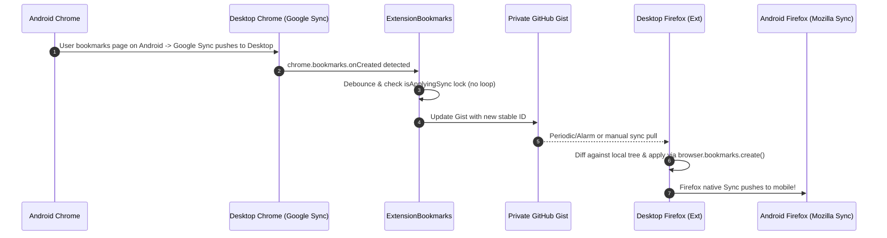

# ExtensionBookmarks: Technical Architecture & Specification

## 1. Executive Summary & Design Goals
**ExtensionBookmarks** is a lightweight, high-performance, cross-browser browser extension (Manifest V3) that unifies:
1. **Native Browser Bookmarks**: `Bookmarks Bar` and `Other Bookmarks` (with `Mobile Bookmarks` normalized as a folder inside `Other Bookmarks`).
2. **Stored Pages (OneTab Stash Sessions)**: Enhanced with custom **Group Folders** (e.g. *YouTube*, *Dev*, *Research*, *Shopping*) and named session batches.
3. **Cross-Browser & Cross-Device Cloud Sync**: Powered by a **Private GitHub Gist** (100% free, version-controlled, zero vendor lock-in).
4. **Independent Sync Toggles**: Enable or disable sync individually for `Bookmarks Bar`, `Other Bookmarks`, and `Stored Pages`.
5. **Non-Interfering Mobile Bridgehead**: Operates cleanly with Google Chrome Account Sync and Firefox Sync, bridging mobile devices (Android Chrome / Firefox Mobile) without requiring mobile extension support.
6. **Local-First & Zero Browser Drag**: Sub-millisecond local operations; service worker stays idle until triggered; offline-first with background network recovery.

---

## 2. Information Architecture: The 3 Core Sections


### Sync Toggle Configuration:
Each section can be independently toggled:
- `syncBookmarksBar`: `true` | `false`
- `syncOtherBookmarks`: `true` | `false` (includes `mobileBookmarks`)
- `syncStoredPages`: `true` | `false`

---

## 3. Data Schema: Multi-File GitHub Gist Architecture

To avoid uploading massive blobs and prevent GitHub's 1MB API truncation limit, the private Gist is partitioned into **3 separate files**:

```
[Your Private Gist]
├── bookmarks.json      # Bookmarks Bar + Other Bookmarks + Mobile Bookmarks
├── stored_pages.json   # Group folders + Tab sessions (OneTab equivalent)
└── settings.json       # Sync toggles, intervals, and device metadata
```

### File 1: `bookmarks.json`
```json
{
  "version": 1,
  "lastModified": 1731050000000,
  "deviceId": "dev_win_chrome_9a2f",
  "bookmarksBar": [
    {
      "id": "bm_4f8a12bc",
      "type": "bookmark",
      "title": "GitHub",
      "url": "https://github.com",
      "dateAdded": 1731000000000,
      "dateModified": 1731000000000
    },
    {
      "id": "fld_99c3de21",
      "type": "folder",
      "title": "Dev Tools",
      "children": [...]
    }
  ],
  "otherBookmarks": [
    {
      "id": "fld_mobile_root",
      "type": "folder",
      "title": "Mobile Bookmarks",
      "isMobileFolder": true,
      "children": [...]
    }
  ],
  "tombstones": {
    "bm_deleted_old_id": 1731030000000
  }
}
```

### File 2: `stored_pages.json`
```json
{
  "version": 1,
  "lastModified": 1731050000000,
  "deviceId": "dev_win_chrome_9a2f",
  "folders": [
    {
      "id": "spf_youtube_01",
      "name": "YouTube",
      "color": "#ff0000",
      "createdAt": 1731010000000
    }
  ],
  "sessions": [
    {
      "id": "sps_78b9e1",
      "folderId": "spf_youtube_01",
      "title": "React 19 Deep Dive",
      "createdAt": 1731020000000,
      "isLocked": false,
      "tabs": [
        {
          "id": "tab_1a2b",
          "title": "React 19 Beta Release",
          "url": "https://react.dev/blog/2024/04/25/react-19",
          "faviconUrl": "https://react.dev/favicon.ico"
        }
      ]
    }
  ]
}
```

### File 3: `settings.json`
```json
{
  "version": 1,
  "syncBookmarksBar": true,
  "syncOtherBookmarks": true,
  "syncStoredPages": true,
  "autoSyncIntervalMinutes": 10,
  "deletionThresholdSafety": 30,
  "theme": "system",
  "lastSyncTime": 1731050000000
}
```

---

## 4. Cross-Browser Root Mapping & Mobile Bridgehead



### Root Normalization Mapping
| Browser | Bookmarks Bar Root ID | Other Bookmarks Root ID | Mobile Bookmarks Handling |
| :--- | :--- | :--- | :--- |
| **Chromium** (Chrome / Edge / Brave) | `"1"` | `"2"` | Root `"3"` mapped into child folder inside `"2"` |
| **Firefox** (Gecko) | `"toolbar_____"` | `"unfiled_____"` | `"mobile______"` mapped into child folder inside `"unfiled_____"` |

---

## 5. Critical Technical Safeguards

1. **Stable Alphanumeric IDs (UUIDs)**:
   - Every bookmark, folder, and tab session has a globally unique ID (`bm_...`, `fld_...`, `sps_...`).
   - Editing a title or URL updates the existing node; it is never treated as a delete + create.
2. **Initial Sync Deduplication & Setup Wizard**:
   - On connecting a new browser profile to an existing Gist, the user is offered:
     - 🔗 *Merge Local with Cloud (Smart Deduplication by normalized URL)*
     - ☁️ *Replace Local with Cloud*
     - 💻 *Replace Cloud with Local*
3. **Tombstones (Anti-Resurrection)**:
   - When a bookmark is deleted locally, its stable ID is added to `tombstones` with a timestamp.
   - Other devices receiving the update remove the matching bookmark instead of re-uploading it.
   - Tombstones older than 30 days are automatically garbage-collected.
4. **Loop / Echo Suppression**:
   - When applying incoming updates from the Gist, an internal lock `isApplyingSync = true` is engaged.
   - Local `chrome.bookmarks.onCreated/onChanged/onRemoved` listeners ignore events fired during the extension's own write operations.
5. **Deletion Failsafe (Anti-Wipeout Guard)**:
   - If an incoming sync batch attempts to delete more than the configured safety threshold (e.g. > 30 items or > 50% of bookmarks), the sync pauses and requests explicit user confirmation in the dashboard.
6. **Local-First & Offline Resilience**:
   - All actions (stashing tabs, creating folders, editing bookmarks) write immediately to `chrome.storage.local`.
   - A queue holds pending sync operations until network connectivity is verified (`navigator.onLine`).
7. **GitHub API Efficiency (ETags)**:
   - Reads include `If-None-Match` headers. If the Gist hasn't changed, GitHub returns `304 Not Modified`, saving bandwidth and preserving the 5,000 req/hr rate limit.

---

## 6. Directory Structure

```
ExtensionBookmarks/
├── manifest.json                  # Manifest V3 (Chrome, Edge, Firefox)
├── .gitignore
├── README.md
├── docs/
│   └── extension_architecture.md  # System Architecture & Spec
├── icons/
│   ├── icon16.png
│   ├── icon32.png
│   ├── icon48.png
│   └── icon128.png
├── src/
│   ├── background/
│   │   └── background.js          # Service worker: alarms, bookmark listeners, stash shortcut
│   ├── sync/
│   │   ├── gist-client.js         # GitHub Gist API (read, write, create, ETag cache, raw fallback)
│   │   ├── diff-engine.js         # 3-way reconciliation, smart deduplication, tombstones
│   │   └── id-store.js            # Local mapping: browser bookmark ID <-> stable ID
│   ├── bookmarks/
│   │   ├── normalizer.js          # Browser root detector (Firefox vs Chrome)
│   │   └── manager.js             # Local bookmark reader & sequential writer
│   ├── stash/
│   │   ├── stash-service.js       # Window / tab grabber, collapse into session, group folders
│   │   └── onetab-importer.js     # OneTab plain text parser & export generator
│   └── ui/
│       ├── popup/
│       │   ├── popup.html         # Quick stash popup & search
│       │   ├── popup.css
│       │   └── popup.js
│       └── dashboard/
│           ├── dashboard.html     # Full OneTab + Bookmark Manager
│           ├── dashboard.css      # Dark & light theme, responsive sidebar
│           └── dashboard.js       # Search, folder grouping, sync controls, settings
```
