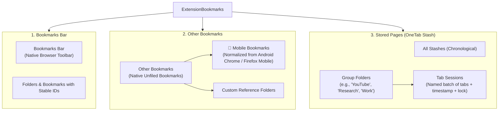
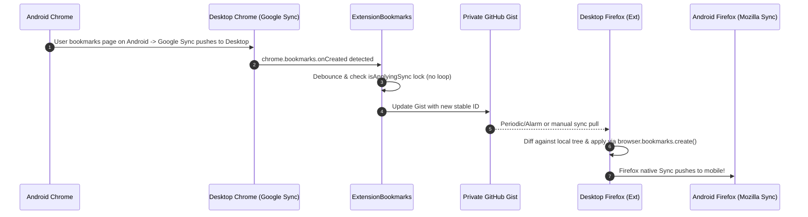

# ExtensionBookmarks: Technical Architecture & Specification

## 1. Executive Summary & Design Goals
**ExtensionBookmarks** is a lightweight, cross-browser browser extension (Manifest V3) that unifies:
1. **Native Browser Bookmarks** (`Bookmarks Bar` and `Other Bookmarks`, including normalized `Mobile Bookmarks`).
2. **Stored Pages (OneTab Stash Sessions)** with enhanced **Group Folders** (e.g. *YouTube*, *Dev*, *Research*).
3. **Cross-Browser & Cross-Device Cloud Sync** powered by **Private GitHub Gists** (100% free, version-controlled, zero vendor lock-in).
4. **Independent Sync Toggles** for each section.
5. **No interference with native Google Account or Firefox Sync** (acting as a mobile bridgehead).

---

## 2. Information Architecture: The 3 Core Sections



### Sync Toggle Configuration:
Each section can be independently toggled:
- `syncBookmarksBar`: `true` | `false`
- `syncOtherBookmarks`: `true` | `false` (includes `mobileBookmarks`)
- `syncStoredPages`: `true` | `false`

---

## 3. Data Schema (GitHub Gist Payload)

The sync file (`extension_bookmarks_sync.json`) stored in your private GitHub Gist uses a unified schema with **alphanumeric stable IDs (UUIDs)** for every node:

```json
{
  "version": 1,
  "lastModified": 1731050000000,
  "deviceId": "dev_win_desktop_chrome_a8f9",
  "settings": {
    "syncBookmarksBar": true,
    "syncOtherBookmarks": true,
    "syncStoredPages": true,
    "autoSyncIntervalMinutes": 10,
    "deletionThresholdSafety": 30
  },
  "bookmarksBar": [
    {
      "id": "bm_4f8a12bc",
      "type": "bookmark",
      "title": "GitHub",
      "url": "https://github.com",
      "dateAdded": 1731000000000,
      "dateModified": 1731000000000
    },
    {
      "id": "fld_99c3de21",
      "type": "folder",
      "title": "Dev Tools",
      "children": [...]
    }
  ],
  "otherBookmarks": [
    {
      "id": "fld_mobile_root",
      "type": "folder",
      "title": "Mobile Bookmarks",
      "isMobileFolder": true,
      "children": [...]
    }
  ],
  "storedPages": {
    "folders": [
      {
        "id": "spf_youtube_01",
        "name": "YouTube",
        "color": "#ff0000",
        "createdAt": 1731010000000
      }
    ],
    "sessions": [
      {
        "id": "sps_78b9e1",
        "folderId": "spf_youtube_01",
        "title": "React 19 Deep Dive",
        "createdAt": 1731020000000,
        "isLocked": false,
        "tabs": [
          {
            "id": "tab_1a2b",
            "title": "React 19 Beta Release",
            "url": "https://react.dev/blog/2024/04/25/react-19",
            "faviconUrl": "https://react.dev/favicon.ico"
          }
        ]
      }
    ]
  },
  "tombstones": {
    "bm_deleted_old_id": 1731030000000
  }
}
```

---

## 4. Cross-Browser Root Mapping & Sync Engine



### Key Technical Safeguards:
1. **Stable Alphanumeric IDs**:
   - Every bookmark, folder, and tab session has a unique ID (`bm_...`, `fld_...`, `sps_...`).
   - Editing a title or URL updates the existing node; it is never treated as a delete + create.
2. **Tombstones (Anti-Resurrection)**:
   - When a bookmark is deleted locally, its stable ID is added to `tombstones` with a timestamp.
   - Other devices receiving the update remove the matching bookmark instead of re-uploading it.
   - Tombstones older than 30 days are automatically garbage-collected.
3. **Loop / Echo Suppression**:
   - When the extension applies incoming updates from the Gist, an internal lock `isApplyingSync = true` is engaged.
   - Local `chrome.bookmarks.onCreated/onChanged/onRemoved` listeners ignore events fired by the extension's own operations.
4. **Deletion Failsafe (Anti-Wipeout Guard)**:
   - If an incoming sync batch attempts to delete more than the configured safety threshold (e.g. > 30 items or > 50% of bookmarks), the sync pauses and requests user confirmation in the dashboard.
5. **Browser Root Normalization**:
   - **Firefox**: `toolbar_____` ➔ Bookmarks Bar, `unfiled_____` ➔ Other Bookmarks, `mobile______` ➔ `Other Bookmarks / Mobile Bookmarks`.
   - **Chromium**: ID `1` ➔ Bookmarks Bar, ID `2` ➔ Other Bookmarks, ID `3` ➔ `Other Bookmarks / Mobile Bookmarks`.

---

## 5. Directory Structure for the Extension

```
ExtensionBookmarks/
├── manifest.json                  # Manifest V3 (Chrome, Edge, Firefox)
├── .gitignore
├── README.md
├── docs/
│   └── extension_architecture.md  # System Architecture & Spec
├── icons/
│   ├── icon16.png
│   ├── icon48.png
│   └── icon128.png
├── src/
│   ├── background/
│   │   └── background.js          # Service worker: alarms, bookmark listeners, stash shortcut
│   ├── sync/
│   │   ├── gist-client.js         # GitHub Gist API (read, write, create, ETag cache)
│   │   ├── diff-engine.js         # 3-way reconciliation, stable ID mapper, tombstones
│   │   └── id-store.js            # Local mapping: browser bookmark ID <-> stable ID
│   ├── bookmarks/
│   │   ├── normalizer.js          # Browser root detector (Firefox vs Chrome)
│   │   └── manager.js             # Local bookmark reader & sequential writer
│   ├── stash/
│   │   ├── stash-service.js       # Window / tab grabber, collapse into session
│   │   └── onetab-importer.js     # OneTab plain text parser & export generator
│   └── ui/
│       ├── popup/
│       │   ├── popup.html         # Quick stash popup & search
│       │   ├── popup.css
│       │   └── popup.js
│       └── dashboard/
│           ├── dashboard.html     # Full OneTab + Bookmark Manager
│           ├── dashboard.css      # Dark & light theme, responsive sidebar
│           └── dashboard.js       # Search, folder grouping, sync controls
```

---

## 6. Implementation Stages
1. **Stage 1: Core Foundation & Manifest V3**
   - Base `manifest.json` with multi-browser support.
   - ID mapper & browser bookmark root normalizer.
2. **Stage 2: Stored Pages (OneTab) & Group Folders**
   - Tab stasher service (Stash window / Stash current tab / Shortcuts).
   - Sidebar with `All`, custom Group Folders (*YouTube*, *Research*, etc.), and sessions.
   - OneTab plain text import/export utility.
3. **Stage 3: GitHub Gist Sync Engine**
   - Gist API integration (PAT authentication, automatic Gist initialization).
   - Diff & merge engine with stable UUIDs and tombstones.
   - Self-trigger / loop suppression & deletion safety guard.
4. **Stage 4: Unified Dashboard & Search UI**
   - High-speed instant search across Bookmarks Bar, Other Bookmarks, and Stored Pages.
   - Settings modal with section sync toggles and credentials.
